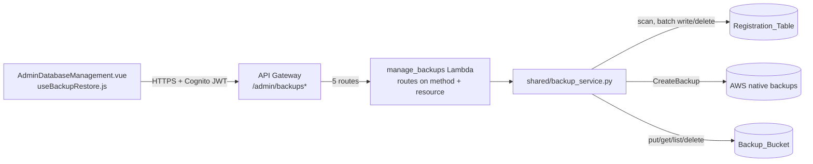
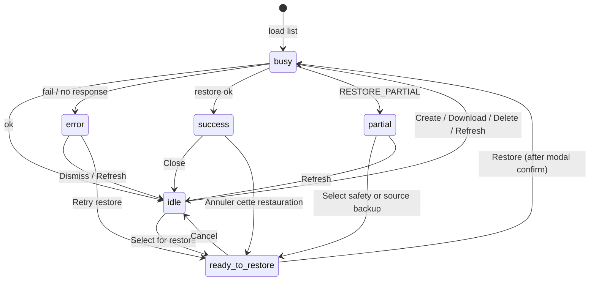

# Design Document: Database Backup & Restore

## Overview

An admin-only page "Gestion de la base" lets an Admin create, list, download, delete and restore full-table backups of `impressionnistes-registration-{env}`.

Design principles:

- **Smallest design that works.** Everything is synchronous (one HTTP call = one operation). The prod table is about 1250 items / 630 KB, so no async jobs, polling, job table or Step Functions.
- **One Lambda, one service module.** A single routing Lambda calls `functions/shared/backup_service.py`.
- **Admin-only through the decorator.** `@require_admin` (Cognito `admins` group), same precedent as `view_payment_analytics`. No permission matrix entries, no migration.
- **State clarity.** Six UI states. A banner always shows the current state, what is possible and what is running.
- **Self-describing backups.** Category, timestamp and (for safety backups) the source backup are readable from the name alone.

### What is added where

| Area | Addition |
|---|---|
| CDK `database_stack.py` | `backup_bucket` (`rcpm-impressionnistes-backups-{env}`) next to `secrets_bucket` |
| CDK `api_stack.py` | `BACKUP_BUCKET` env var, ONE Lambda `ManageBackupsFunction` (120 s / 512 MB), 5 routes under `/admin/backups` pointing to it, extra IAM |
| `functions/shared/backup_service.py` | All logic: scan, serialize, S3 I/O, native backup, purge, write, restore, audit |
| `functions/admin/manage_backups.py` | Single handler: routes on HTTP method + resource, calls the service |
| Frontend | route `/admin/database`, view, 4 components, composable `useBackupRestore.js`, util `backupNaming.js`, i18n keys, nav + dashboard entries |
| Tests | `tests/integration/test_database_backup_restore.py`, vitest for util + composable |

Not added: permission matrix entries, `init_config.py` change, migration script, bucket lifecycle rule, native backup listing.

### Relation to existing Makefile targets

| Existing target | Relation |
|---|---|
| `make db-backup` | Same kind of artifact as the native backup created with every JSON backup. |
| `make db-list-backups` | Where native backups (including those created by this feature, named `{table}-{category}_{timestamp}`) are visible. The UI does not list them. |
| `make db-restore-backup` | Restores a native backup into a **new** `-restored` table. Out-of-band fallback. The feature's JSON restore is the in-place full replacement. |

No new Makefile target is required. Deploy and test use `make deploy-dev`, `make deploy-frontend-dev`, `make test`, `make test-frontend`.

## Architecture



### Key decisions

| Decision | Choice | Why |
|---|---|---|
| Lambda layout | ONE Lambda with routing + 1 shared module | Fewer resources (also avoids the CloudFormation 500-resource concern noted in `api_stack.py`), one IAM grant set, one place to test. No existing routing Lambda in the repo, so the minimal approach is used (below). |
| Auth | `@require_admin` only | Same as `view_payment_analytics`. Admin-only is enforced by the decorator and tested with a non-admin rejection test. |
| Download | Return the backup content in the response body | File is about 1 MB, far below the 6 MB Lambda / 10 MB API Gateway limits. No presigned URL, no S3 CORS. Revisit above about 4 MB. |
| Item serialization | **DynamoDB JSON via the low-level client** (`scan` output written as-is, `batch_write_item` input read as-is) | No Decimal/float conversion, so round-trip is exact. Only transform: `B`/`BS` bytes to/from base64. |
| Metadata | In the file name + S3 object metadata + embedded in the envelope | Name gives category/time/source for free; object metadata gives count/creator via one `HeadObject`. |
| Concurrency guard | None server-side; UI disables all actions while busy | Single-admin, rare operation. |
| Native backup name | `{table_name}-{category}_{timestamp}` (no source part) | DynamoDB limits `BackupName` to 3-255 chars `[a-zA-Z0-9_.-]`. The name is bounded (about 74 chars) and independent of any chain; the source reference lives in the key reference, S3 metadata, envelope and audit. |

### Routing in the single Lambda

No multi-route Lambda exists in the repo (every handler serves one route), so the handler routes on the API Gateway proxy fields `httpMethod` and `resource` (the route template, e.g. `/admin/backups/{backup_id}/restore`):

```python
ROUTES = {
    ("POST",   "/admin/backups"):                          backup_service.handle_create,
    ("GET",    "/admin/backups"):                          backup_service.handle_list,
    ("GET",    "/admin/backups/{backup_id}/download"):     backup_service.handle_download,
    ("DELETE", "/admin/backups/{backup_id}"):              backup_service.handle_delete,
    ("POST",   "/admin/backups/{backup_id}/restore"):      backup_service.handle_restore,
}

@handle_exceptions
@require_admin
def lambda_handler(event, context):
    user = get_user_from_event(event)
    handler = ROUTES.get((event["httpMethod"], event["resource"]))
    if handler is None:
        return error_response(404, "NOT_FOUND", "Unknown route")
    return handler(event, user)   # handlers read path parameter / body themselves
```

In `api_stack.py` one `LambdaIntegration` is created and attached to all five methods (see CDK wiring below).

### Backup_Bucket ownership and removal policy

- Defined in `DatabaseStack` beside `secrets_bucket`, exposed as `self.backup_bucket`.
- Settings: `S3_MANAGED` encryption, `versioned=True`, `BLOCK_ALL`, `enforce_ssl=True`.
- Removal policy follows the **table's** policy (`removal_policy_database`, `RETAIN`). Backups are never auto-deleted with the stack.
- No `auto_delete_objects`: after a manual stack teardown the bucket must be emptied and deleted by hand before redeploying with the same name.

```python
self.backup_bucket = s3.Bucket(
    self, "BackupBucket",
    bucket_name=f"rcpm-impressionnistes-backups-{env_name}",
    block_public_access=s3.BlockPublicAccess.BLOCK_ALL,
    encryption=s3.BucketEncryption.S3_MANAGED,
    enforce_ssl=True,
    versioned=True,
    removal_policy=removal_policy,          # same variable as the table
)
```

### IAM and Lambda sizing

`_create_lambda_function` already grants table read/write. `ManageBackupsFunction` adds one set:

| Setting | Value |
|---|---|
| Bucket | `backup_bucket.grant_read_write` |
| DynamoDB | `dynamodb:CreateBackup` on the table (only the `CreateBackup` response is used: ARN and status; no other backup action is needed) |
| Timeout / memory | **120 s** / 512 MB |
| Env | `BACKUP_BUCKET` added to `common_env` |

### CDK wiring

- `ApiStack` already receives the whole `database_stack` object (like `database_stack.secrets_bucket`), so the bucket is `database_stack.backup_bucket`. No change in `infrastructure/app.py`.
- `_create_lambda_function(self, function_id, handler_path, description, timeout=30)` hardcodes `memory_size=256`; add an optional `memory_size=256` parameter. Handler path: `admin/manage_backups`, registered in `self.lambda_functions['manage_backups']`.
- Routes: `admin_resource.add_resource('backups')`, then `add_method(..., apigateway.LambdaIntegration(fn, proxy=True), authorizer=self.authorizer, authorization_type=apigateway.AuthorizationType.COGNITO)`; sub-resources `{backup_id}`, `download`, `restore`. CORS preflight is handled by the API-level `default_cors_preflight_options` (no per-route work).

### Duration vs API Gateway 29 s limit

Estimate for the prod table (1250 items, about 630 KB):

| Step | Estimated time |
|---|---|
| Consistent scan (1 to 2 pages) | under 1 s |
| JSON build + S3 put (about 1.3 MB) | under 1 s |
| Native `CreateBackup` (returns immediately) | about 1 s |
| Purge: 50 `BatchWriteItem` | about 2 s |
| Write: 50 `BatchWriteItem` | about 2 s |
| Verify count scan | under 1 s |
| **Restore total** | **about 8 to 10 s** |

Revisit (async job) when the table exceeds about 10,000 items or about 5 MB, or when a restore takes more than 15 s.

The Lambda timeout (120 s) is deliberately longer than the API Gateway limit: if API Gateway returned 504 at 29 s, a shorter timeout would kill the function mid-purge. With 120 s the restore finishes even if the client gave up; the UI handles this in the `error` state (outcome unknown).

### Behaviors to know

| Topic | Behavior |
|---|---|
| **Backup_Bucket during restore** | Never purged. Restore only reads the source and writes the new safety backup object. |
| **AUDIT# records** | Only the `AUDIT#DATABASE_BACKUP` partition (`AUDIT_PK`, the Backup_Audit_Records) is preserved: the purge skips it and the backup's own records are written back, so the result is the union of both. Other `AUDIT#` partitions (permission audit logs) are fully replaced by the backup's. The restore's own audit record is written after the rewrite and verification, so it is present in the final table. An undo follows the same rule, so the audit records of both restores remain. |
| **Admin access** | Comes from Cognito groups, not table data, so restoring an old backup cannot lock the admin out. |
| **Cognito vs `USER#`** | Cognito users are not in the table; an old backup can leave accounts and `USER#` records out of sync. The confirmation modal says so. No reconciliation. |
| **DynamoDB Streams** | Enabled on the table, but no stream consumer exists in `infrastructure/stacks/` or `functions/`. If one is added, disable it or make it idempotent before restoring. |
| **GSIs** | Maintained by DynamoDB on every write. Nothing to do. |
| **Other users during restore** | The app can show empty data for a few seconds. The modal recommends restoring outside active registration hours. |
| **Same-second collisions** | Ids have 1 s resolution; versioning keeps the older object. Acceptable. |
| **PITR** | Enabled for dev and prod: one more fallback, mentioned in the recovery instructions. |

## Components and Interfaces

### Backup naming (exact format)

`backup_id` is both the S3 key (bucket root, no `/`) and the URL path parameter.

| Item | Format | Example |
|---|---|---|
| Timestamp | UTC, `YYYY-MM-DDTHH-MM-SSZ` | `2026-11-01T14-30-00Z` |
| Manual | `manual_{timestamp}.json` | `manual_2026-11-01T14-30-00Z.json` |
| Safety | `safety-pre-restore_{timestamp}_before-restore-of_{source_ref}.json` | `safety-pre-restore_2026-11-02T09-00-00Z_before-restore-of_manual_2026-11-01T14-30-00Z.json` |
| Safety (undo of the safety backup above) | same format | `safety-pre-restore_2026-11-02T09-05-00Z_before-restore-of_safety-pre-restore_2026-11-02T09-00-00Z.json` |
| `source_ref` | `{source_category}_{source_timestamp}` | `manual_2026-11-01T14-30-00Z` |
| Native backup name | `{table_name}-{category}_{timestamp}` | `impressionnistes-registration-prod-safety-pre-restore_2026-11-02T09-00-00Z` |

- **Sortable**: fixed-width ISO timestamp, so lexicographic order within a category is chronological.
- **Parseable**: categories and timestamps contain no `_`; a safety id is split once on `_before-restore-of_`.
- **Unambiguous source**: `source_ref` (category + timestamp) identifies the source backup, so the key alone tells which backup a safety backup was taken from. The FULL real source id is stored in the S3 object metadata (`source-backup-id`), the envelope metadata (`source_backup_id`) and the audit record.
- **Bounded**: ids are about 110 chars at any restore/undo depth; the native backup name `{table_name}-{category}_{timestamp}` is also bounded (about 74 chars).
- **Validated** before touching S3 (prevents key injection): `^(manual|safety-pre-restore)_\d{4}-\d{2}-\d{2}T\d{2}-\d{2}-\d{2}Z(_before-restore-of_(manual|safety-pre-restore)_\d{4}-\d{2}-\d{2}T\d{2}-\d{2}-\d{2}Z)?\.json$`. A safety id must contain exactly one source reference, a manual id none.

> **Note (database-reset spec):** a third category `safety-pre-reset` exists, introduced by the `database-reset` spec. Id `safety-pre-reset_{timestamp}.json` (no source part, like `manual`), native name `{table_name}-safety-pre-reset_{timestamp}`, badge "Sécurité avant purge". The id regex alternation becomes `manual|safety-pre-restore|safety-pre-reset`, also for the `source_ref` of a `safety-pre-restore` (a `safety-pre-reset` backup can be the source of a safety-pre-restore, the undo of a purge). A source part is required for `safety-pre-restore` only.

### Backup file format (envelope)

```json
{
  "format_version": 1,
  "metadata": {
    "backup_id": "safety-pre-restore_2026-11-02T09-00-00Z_before-restore-of_manual_2026-11-01T14-30-00Z.json",
    "category": "safety-pre-restore",
    "created_at": "2026-11-02T09:00:00Z",
    "created_by": "admin@example.org",
    "item_count": 1250,
    "table_name": "impressionnistes-registration-prod",
    "environment": "prod",
    "source_backup_id": "manual_2026-11-01T14-30-00Z.json"
  },
  "items": [
    {"PK": {"S": "TEAM#t1"}, "SK": {"S": "BOAT#b1"}, "price": {"N": "12.50"},
     "tags": {"SS": ["a", "b"]}, "blob": {"B": "aGVsbG8="},
     "crew": {"L": [{"M": {"name": {"S": "x"}, "age": {"N": "54"}}}]}}
  ]
}
```

| Rule | Detail |
|---|---|
| Source of items | `client.scan(TableName, ConsistentRead=True)` on the table, following `LastEvaluatedKey`. Typed items used unchanged. |
| Numbers / sets / nested / null / bool | Stay in DynamoDB typed form (`N` stays a string). No `Decimal` or `float`. |
| Binary | `B` / `BS`: bytes to base64 on write, base64 to bytes before `batch_write_item`, via one recursive helper over `M`/`L`. |
| JSON dump | `json.dumps(envelope, separators=(",", ":"), ensure_ascii=False)`, UTF-8. |
| Comparison | As a set keyed by `(PK, SK)`; item order is not significant. |

`TypeSerializer`/`Deserializer` are not used: they would produce `Decimal` and `Binary` objects and need a custom encoder.

### S3 object metadata (cheap listing)

Each object is written with ASCII `Metadata`: `category`, `created-at`, `created-by`, `item-count`, and `source-backup-id` (safety only). Listing = `list_objects_v2` then one `head_object` per key. Category, timestamp and source are also parsed from the key, so a hand-uploaded object still shows category and time (`item_count` / `created_by` are `null`). Fine for tens of backups.

### Shared module `functions/shared/backup_service.py`

Constants (mirrored in `frontend/src/utils/backupNaming.js`):

```python
CATEGORY_MANUAL = "manual"
CATEGORY_SAFETY = "safety-pre-restore"
CONFIRMATION_PHRASE = "RESTAURER LA BASE"
SOURCE_MARKER = "_before-restore-of_"
FORMAT_VERSION = 1
AUDIT_PK = "AUDIT#DATABASE_BACKUP"
```

| Function | Purpose |
|---|---|
| `make_backup_id` / `parse_backup_id` | Build / parse the id per the naming rules (raises `InvalidBackupId`). `parse_backup_id` returns `category`, `timestamp`, `created_at`, `source_ref` (and `source_stem` alias); the full `source_backup_id` comes from S3 metadata, not from the key |
| `scan_table`, `encode_items`, `decode_items` | Consistent paginated scan; base64 transform |
| `build_envelope` / `validate_envelope` | Build / validate (restore step 4) |
| `create_backup(category, user, source_id=None)` | JSON to S3 with metadata, then native backup named `{table_name}-{category}_{timestamp}`. Used by manual create and by restore for the safety backup |
| `list_backups()` | JSON backups from S3 only, newest first |
| `read_backup`, `delete_backup` | `get_object` + parse; `head_object` 404 check then delete |
| `purge_table`, `write_items`, `batch_write_with_retry` | Batch delete / put; up to 8 attempts, backoff 50 ms doubling (cap 1 s), then `BatchWriteError` |
| `restore_backup(backup_id, phrase, user)` | Ordered algorithm below |
| `write_audit(table, action, user, details)` | Writes the audit item |
| `handle_create/list/download/delete/restore(event, user)` | Thin adapters returning `success_response` / `error_response` |

### API contract

All routes under `/admin`, Cognito authorizer, `@require_admin`. Responses use the existing envelope: success `{"success": true, "data": {...}, "timestamp": "..."}`, error `{"success": false, "error": {"code", "message", "details"}, "timestamp": "..."}`.

| Method + path | Request | Success (`data`) |
|---|---|---|
| `POST /admin/backups` | none | `201` `{backup_id, category, item_count, size_bytes, created_at, native_backup: {name, arn, status}}` |
| `GET /admin/backups` | none | `200` `{backups: [Backup]}` (JSON backups only, newest first) |
| `GET /admin/backups/{backup_id}/download` | none | `200` `{backup_id, filename, content: <envelope>}` |
| `DELETE /admin/backups/{backup_id}` | none | `200` `{backup_id, deleted: true}` |
| `POST /admin/backups/{backup_id}/restore` | `{"confirmation_phrase": "RESTAURER LA BASE"}` | `200` `RestoreResult` |

The Admin identity comes from the Cognito claims, never from the body. The frontend builds a `Blob` from `content` for the browser download.

### Restore algorithm (ordered steps)

`restore_backup(backup_id, phrase, user)`:

| # | Step | On failure |
|---|---|---|
| 1 | Admin check: `@require_admin` | `403 FORBIDDEN`, nothing done |
| 2 | Validate `backup_id` format | `400 INVALID_BACKUP_ID` |
| 3 | Validate `phrase == CONFIRMATION_PHRASE` (exact, case-sensitive, server-side) | `400 INVALID_CONFIRMATION` |
| 4 | **Load and validate source** (`get_object`, JSON parse, `format_version == 1`, `items` is a list, every item has string `PK` and `SK`, no duplicate `(PK, SK)`, `metadata.item_count == len(items)`, base64 decodes) | `404 BACKUP_NOT_FOUND` or `422 BACKUP_INVALID`. Table untouched. |
| 5 | **Create Safety_Backup** via `create_backup(CATEGORY_SAFETY, user, source_id=backup_id)`. JSON and native backup must both succeed. | `500 SAFETY_BACKUP_FAILED`, abort, **no purge** |
| 6 | **Purge**: full consistent scan, delete by (PK, SK) every item whose `PK != AUDIT_PK`, batch delete in chunks of 25 with retry. Items with `PK == AUDIT_PK` are kept and their keys recorded (`preserved_audit_count`). `purged_count` excludes them. | `500 RESTORE_PARTIAL` (stage `purge`) |
| 7 | **Write**: decode items, batch put ALL source items (including its own `AUDIT_PK` records; a put on an existing identical audit key is a harmless overwrite) in chunks of 25 with retry. Result: source non-audit items ∪ (preserved audit records ∪ source audit records). `restored_count` = number of source items written. | `500 RESTORE_PARTIAL` (stage `write`) |
| 8 | **Verify**: consistent `Select="COUNT"` scan equals `expected = \|source keys ∪ preserved audit keys\|`, computed from the key sets before the write. The restore's own audit record is written after this step, so it is not counted. | `500 RESTORE_PARTIAL` (stage `verify`) |
| 9 | **Audit**: write the `restore_backup` record (after the rewrite, so the restored table contains it) | Logged; `audit_written: false` (not a restore failure) |
| 10 | Return `RestoreResult` | n/a |

- Exceptions in steps 6 to 8 are caught once at the top level and converted to `RESTORE_PARTIAL` with `details = {safety_backup_id, safety_native_backup, source_backup_id, stage, purged_count, written_count, steps}`. No extra audit write on failure.
- Recovery is always possible by restoring the safety backup, or re-running the same source (full replacement is idempotent).
- Failures in steps 2 to 5 never modify the table.

### Audit records

| Field | Value |
|---|---|
| `PK` / `SK` | `AUDIT#DATABASE_BACKUP` / `{timestamp}#{user_id}` |
| `action` | `create_backup`, `delete_backup`, `restore_backup` |
| `user_id`, `user_email`, `timestamp` | from claims / UTC now |
| `details` | `backup_id`, `item_count`, `source_backup_id`, `safety_backup_id`, `purged_count`, `restored_count` as relevant |

`clear_audit_logs` only deletes the `AUDIT#PERMISSION_*` partitions, so these records are unaffected.

### Frontend design

#### Files

| File | Role |
|---|---|
| `router/index.js` | route `/admin/database`, `meta: { requiresAuth: true, requiresAdmin: true }` (non-admins redirected by the existing guard) |
| `App.vue` / `AdminDashboard.vue` | nav item (`v-if="authStore.isAdmin"`) and one dashboard card |
| `views/admin/AdminDatabaseManagement.vue` | Page: title, `BackupRestoreSection`, `DatabaseResetPlaceholder` |
| `components/admin/BackupRestoreSection.vue` | Banner, toolbar, list (`SortableTable` desktop + `DataCard` mobile, same fields/actions; `components/base/LoadingSpinner.vue` while loading), delete confirmation via existing `useConfirm`, restore panel + confirm modal, result panels |
| `components/admin/RestorePanel.vue` | Selected backup summary + category badge, phrase `FormGroup`, Restore button, confirmation `BaseModal` |
| `components/admin/RestoreResultPanel.vue` | `success`, `error`, `partial` content and undo panel |
| `components/admin/DatabaseResetPlaceholder.vue` | Disabled `DataCard` "Bientôt disponible" (reserved for `database-reset`) |
| `composables/useBackupRestore.js` | API calls + state logic (single source of truth) |
| `utils/backupNaming.js` | `CONFIRMATION_PHRASE`, `CATEGORY_*`, `SOURCE_MARKER`, `parseBackupId`, `categoryBadge`, `isPhraseValid` |
| `locales/fr.json`, `en.json` | keys under `admin.database.*`, `nav.databaseManagement` |

API access reuses `services/apiClient`.

#### Category badge

`StatusBadge` renders its default slot, so no custom badge CSS is needed:

| Category | `status` | Label (fr) |
|---|---|---|
| `manual` | `paid` (blue) | "Manuelle" |
| `safety-pre-restore` | `incomplete` (yellow) | "Sécurité avant restauration" |

```vue
<StatusBadge :status="badge.status" size="medium">{{ $t(badge.labelKey) }}</StatusBadge>
```

Safety rows also show "avant restauration de : {source_ref}" in plain text.

#### UI state model (6 states)

A banner at the top of the section always shows **the current state, what is possible, and what is running** (`busyLabel`).

| State | Meaning | Banner (fr, summary) |
|---|---|---|
| `idle` | List shown. Also the empty state ("Aucune sauvegarde disponible") and list loading (spinner inside the list). | "Prêt. N sauvegardes." |
| `busy` | An operation is running; `busyLabel` is one of: creating backup, downloading, deleting, restoring. Everything else is disabled. | "{busyLabel} en cours…" (restoring adds "ne fermez pas la page, moins de 15 s") |
| `ready_to_restore` | A backup is selected: its category badge is shown, phrase input, Restore button enabled only when the phrase matches exactly. | "Restauration de {id} : saisissez la phrase de confirmation" |
| `success` | Restore done: counts and undo panel pointing to the safety backup with **"Annuler cette restauration"**. | "Restauration terminée : {purged} supprimés, {restored} restaurés." |
| `error` | The operation failed and the database was NOT modified (list, create, download, delete, or restore before purge). Says "Rien n'a été modifié dans la base". Also covers **outcome unknown** (no response / 504): "Aucune réponse du serveur. La restauration a pu se terminer ou échouer. Actualisez la liste et vérifiez l'état de la base avant toute action." | Error message by code |
| `partial` | Restore failed AFTER the purge started: prominent warning, safety backup id, step reached, recovery instructions. | "ÉTAT PARTIEL : la base est incomplète" |



Enabled actions per state (`✔` enabled, `—` disabled, "hidden" = not shown):

| State | Create | Refresh | Download | Delete | Select for restore | Phrase input | Restore button |
|---|---|---|---|---|---|---|---|
| `idle` | ✔ | ✔ | ✔ | ✔ | ✔ | hidden | hidden |
| `busy` | — | — | — | — | — | hidden or disabled | — |
| `ready_to_restore` | ✔ | ✔ | ✔ | — (selected row) | ✔ (change choice) | ✔ | ✔ only if phrase matches |
| `success` | — | ✔ ("Fermer") | — | — | ✔ safety backup only | hidden | hidden |
| `error` | ✔ | ✔ ("Réessayer") | ✔ | ✔ | ✔ | hidden (kept if retrying a restore) | ✔ if retrying and phrase matches |
| `partial` | — | ✔ | ✔ | — | ✔ safety backup and source only | ✔ (empty) | ✔ only if phrase matches |

Rules:

- While `busy`, every action is disabled; the running action shows a `BaseButton` `:loading` spinner.
- Destructive controls start unselected and empty (Req 8.5).
- In `partial`, Create is disabled so a half-empty table is not backed up as if it were good.
- The final confirmation modal (`BaseModal`) is a UI detail of `ready_to_restore`, not a state.
- Delete uses the existing promise-based `useConfirm` composable (as in `views/admin/AdminPermissionAuditLogs.vue`) before entering `busy`; no custom delete modal. The restore confirmation stays a `BaseModal` because it shows rich content.

#### Restore flow

1. In `idle`, the admin clicks **"Restaurer…"** on a row (`size="small"`, `variant="danger"`). The row is highlighted and the restore panel opens (`ready_to_restore`).
2. The panel shows the selected id, its **category badge** (Req 8.8), the source for a safety backup, and what will happen: data replaced by N items, a safety backup created first, Cognito users not restored.
3. The admin types `RESTAURER LA BASE` in a `FormGroup` input (phrase shown as help text). The Restore button stays disabled until it matches exactly.
4. **Restaurer** (`danger`, `medium`) opens the confirmation modal:
   - "Cette action remplace TOUTES les données actuelles par le contenu de **{id}** ({item_count} éléments, catégorie {badge})."
   - "Une sauvegarde de sécurité sera créée avant : `safety-pre-restore_<horodatage>_before-restore-of_{source_ref}.json`."
   - "Pour annuler : restaurez cette sauvegarde de sécurité après la restauration."
   - "Les comptes Cognito ne sont pas restaurés. L'application peut afficher des données vides quelques secondes."
   - Footer: Annuler (`secondary`, medium) | Confirmer la restauration (`danger`, medium).
5. Confirm moves to `busy` (label "restauration"). The restore is one synchronous request, so no live step is shown; the panel says it usually takes under 15 seconds. On completion the result lists the ordered steps (safety backup, purge, write, verify) with ✔ and counts, or ✖ at the failed step.

#### Result screens

| State | What the panel shows | How to go back |
|---|---|---|
| `success` | Success `MessageAlert` with counts. Highlighted `DataCard` **"Pour annuler cette restauration"** with the safety backup (id, badge, item count) and a `size="small"` button **"Annuler cette restauration"** that selects it (`ready_to_restore`, phrase still required). | Restore the safety backup. |
| `error` | Error `MessageAlert` with the translated code message and "Rien n'a été modifié dans la base." For the outcome-unknown case: wait about 1 minute, click "Actualiser", check whether a new `safety-pre-restore_…` backup exists (the restore started) and verify the data; if it looks empty or wrong, restore that safety backup. The Lambda keeps running up to 120 s. | Fix the cause and retry, or follow the unknown-outcome instructions. |
| `partial` | Error `MessageAlert` "État partiel : la table a été purgée mais la restauration n'est pas terminée." Step list with the failed step, safety backup id and native backup name, counts. Instructions: 1) Ne pas utiliser l'application. 2) **"Restaurer la sauvegarde de sécurité"** (selects it, type the phrase) or retry with the source. 3) If that fails again: `make db-restore-backup BACKUP_ARN=<arn>`; PITR is also enabled. | Restore the safety backup or retry the source. |

#### Composable `useBackupRestore.js`

```js
const { state, busyLabel, backups, selected, phrase, result, error,
        load, create, download, remove, select, setPhrase,
        confirmRestore, dismiss } = useBackupRestore()
```

- `state` is one of `idle | busy | ready_to_restore | success | error | partial`; transitions only happen inside the composable.
- `canRestore = (state in {ready_to_restore, error, partial}) && selected && isPhraseValid(phrase)`.
- Pure helper `nextStateFromRestoreError(err)` (exported, unit-testable). Errors come through `services/apiClient` (axios, 30 s timeout; the response interceptor keeps `err.response`):

| Error | State |
|---|---|
| `err.response.data.error.code === 'RESTORE_PARTIAL'` | `partial` |
| Any other envelope code | `error` |
| No `err.response` (network error, CORS-masked 401, `err.code === 'ECONNABORTED'` timeout), HTTP 504, or non-envelope body | `error` with the outcome-unknown message |

- A 401 makes the interceptor redirect to login; after logging in, the admin must check the list (same instructions as outcome unknown).

#### i18n

Keys under `admin.database` in `fr.json` (primary) and `en.json`: `title`, `states.*`, `actions.*`, `category.*`, `list.*`, `restore.*`, `errors.<CODE>`, `reset.placeholder*`; plus `nav.databaseManagement` ("Gestion de la base" / "Database management"). The Confirmation_Phrase is not translated; it is interpolated from the constant.

#### Design-system compliance

`BaseButton` for all buttons (`small` in rows/cards, `medium` in modals and panel actions); `StatusBadge` for categories; `FormGroup` for the phrase; `MessageAlert` for banners and errors; `BaseModal` for the restore confirmation (delete uses `useConfirm`); `LoadingSpinner` for list loading; `SortableTable` + `DataCard` with identical fields and actions (id, category badge, created_at, item_count, size, created_by, source, Télécharger / Supprimer / Restaurer…); card header with bottom border; design tokens only.

## Data Models

### Backup (list row and create result)

| Field | Type | Source |
|---|---|---|
| `backup_id` | string | S3 key |
| `category` | `"manual"` \| `"safety-pre-restore"` | key (authoritative) |
| `created_at` | ISO-8601 UTC string | parsed from key |
| `item_count` | integer \| null | S3 metadata |
| `size_bytes` | integer | S3 listing |
| `created_by` | string \| null | S3 metadata |
| `source_backup_id` | string \| null | full real source id, from S3 metadata (null if missing) |
| `source_ref` | string \| null | `{source_category}_{source_timestamp}` parsed from the key (safety only); authoritative for display |

### RestoreResult

```json
{
  "source_backup_id": "manual_2026-11-01T14-30-00Z.json",
  "purged_count": 1240,
  "restored_count": 1250,
  "preserved_audit_count": 10,
  "safety_backup": {
    "backup_id": "safety-pre-restore_2026-11-02T09-00-00Z_before-restore-of_manual_2026-11-01T14-30-00Z.json",
    "native_backup": {"name": "impressionnistes-registration-prod-safety-pre-restore_2026-11-02T09-00-00Z", "arn": "arn:aws:dynamodb:..."}
  },
  "steps": [
    {"name": "safety_backup", "status": "ok", "count": 1250},
    {"name": "purge", "status": "ok", "count": 1240},
    {"name": "write", "status": "ok", "count": 1250},
    {"name": "verify", "status": "ok", "count": 1255}
  ],
  "audit_written": true,
  "duration_ms": 8400
}
```

`purged_count` excludes the preserved `AUDIT#DATABASE_BACKUP` records (`preserved_audit_count`). The verify count is the union of source keys and preserved audit keys (here 5 preserved audit records are not in the source).

`RESTORE_PARTIAL` error `details`: same shape plus `stage` (`purge` | `write` | `verify`), `purged_count`, `written_count`, `preserved_audit_count`; each step is `ok`, `failed` or `skipped`.

### Constants kept aligned

| Constant | Backend | Frontend |
|---|---|---|
| Categories, phrase, source marker | `backup_service.py` | `utils/backupNaming.js` |
| Error codes | Error Handling table | `errors.<CODE>` i18n keys |

A light alignment test reads `backupNaming.js` and asserts the same phrase, category identifiers and marker.

## Correctness Properties

*A property is a characteristic or behavior that should hold true across all valid executions of a system-essentially, a formal statement about what the system should do. Properties serve as the bridge between human-readable specifications and machine-verifiable correctness guarantees.*

**Validation approach:** the project forbids the Hypothesis library. Each property is validated by explicit parametrized pytest cases (backend) or table-driven vitest cases (frontend) enumerating the inputs of the "for any" statement. No property-testing library is used.

Properties on permissions and native-backup listing were removed with those features. Overlapping candidates were merged.

### Property 1: Backup captures every item faithfully

*For any* table content (including `USER#`, `CONFIG`, `RACE`, `CLUB`, `TEAM#...`, `TEMP_ACCESS#`, `AUDIT#` items and items with `N`, `SS`, `NS`, `BS`, `B`, nested `M`/`L`, `BOOL`, `NULL`), the created JSON_Backup contains exactly the table's items with all attributes unchanged, and `metadata.item_count` equals the number of items.

**Validates: Requirements 3.1, 3.3, 10.1, 10.2**

### Property 2: Backup identifier encodes category and time

*For any* category in {`manual`, `safety-pre-restore`} and any UTC time, the generated `backup_id` parses back to the same category and timestamp and matches the documented format; a safety id also parses back to its `source_ref`; manual ids never contain the source marker. Restoring a safety backup (undo) repeatedly, at depth 1 to 6 of restore then undo, always produces valid ids that parse back with the right category, timestamp and `source_ref`; ids stay under 150 chars and native names under 100 chars (explicit parametrized cases on the pure naming functions).

**Validates: Requirements 3.2, 3.8, 3.9, 7.7, 7.8**

### Property 3: Restore round trip

*For any* valid source backup and *any* current table content, after a successful restore the table's item set, excluding the `AUDIT#DATABASE_BACKUP` partition, equals the source's item set excluding that partition, and creating a new JSON_Backup yields the same item set under the same exclusion. Also, *for any* Backup_Audit_Record present before a restore, it is still present after it (the audit partition is the union of preserved and source records).

**Validates: Requirements 7.1, 7.2, 7.10, 7.11, 7.12, 10.3, 11.4**

### Property 4: Restore reports accurate counts

*For any* successful restore, `purged_count` equals the number of items in the table before the purge minus the preserved `AUDIT#DATABASE_BACKUP` records, `restored_count` equals the number of items in the source, and the expected verify count (and the table count right after the write) equals the size of the union of source keys and preserved audit keys.

**Validates: Requirements 7.3, 7.11, 7.13**

### Property 5: Safety backup precedes purge

*For any* restore, a complete Safety_Backup (JSON object with category `safety-pre-restore`, source reference, and a native backup) exists before the first delete is issued, and its item set equals the pre-restore table's item set.

**Validates: Requirements 7.4, 7.7, 7.8**

### Property 6: Failed safety backup aborts without purge

*For any* failure of the safety backup (JSON write or native backup), the restore returns an error and the table's item set is identical to its content before the call.

**Validates: Requirements 7.5**

### Property 7: Invalid source leaves the table untouched

*For any* restore request whose source is missing, not valid JSON, has the wrong `format_version`, has items without `PK`/`SK`, has duplicate keys, or has a disagreeing `item_count`, the restore returns `BACKUP_NOT_FOUND` or `BACKUP_INVALID`, the table is unchanged and no Safety_Backup is created.

**Validates: Requirements 8.6, 8.7**

### Property 8: Wrong confirmation phrase is rejected server-side

*For any* phrase that is not exactly `RESTAURER LA BASE` (different case, extra whitespace, empty, missing), the restore returns `INVALID_CONFIRMATION` and the table is unchanged.

**Validates: Requirements 8.2**

### Property 9: Partial failure reports the safety backup

*For any* failure injected after the purge started (purge, write or verify), the response is `RESTORE_PARTIAL` with the Safety_Backup identifier, the failed stage and the counts reached; restoring that Safety_Backup returns the table to its pre-restore item set.

**Validates: Requirements 9.1, 9.2**

### Property 10: Non-admin requests are rejected without effect

*For any* of the five backup routes and any non-admin caller, the response is 403 and no S3 object, native backup or table item is created, changed or deleted.

**Validates: Requirements 2.1, 2.2**

### Property 11: List, download and delete reflect the bucket

*For any* set of stored backups, the list returns exactly those JSON backups with the category parsed from each id; deleting one removes exactly that entry; downloading one returns exactly the stored envelope.

**Validates: Requirements 4.1, 4.2, 5.1, 6.1, 6.3**

### Property 12: Every state-changing action is audited

*For any* create, delete or successful restore, exactly one `AUDIT#DATABASE_BACKUP` record is written with the action, the admin identity and the timestamp; for a restore the record is present in the table after the restore.

**Validates: Requirements 11.1, 11.2, 11.3**

### Property 13: UI action availability follows the state model

*For any* of the six UI states, the set of enabled actions equals the documented set; with no selected backup or a phrase different from the Confirmation_Phrase the Restore action is disabled; in `busy` every action is disabled.

**Validates: Requirements 1.6, 3.7, 5.3, 7.6, 8.1, 8.3, 8.4, 8.5**

### Property 14: Restore error classification

*For any* restore error response, the UI state is `partial` for `RESTORE_PARTIAL` (always exposing the safety backup id) and `error` for every other code and for no response; the no-response case shows the outcome-unknown message.

**Validates: Requirements 9.3, 9.4**

## Error Handling

All errors use `error_response(status, code, message, details)`. The UI translates by `code`.

| Code | HTTP | When | Table modified? | UI state |
|---|---|---|---|---|
| `UNAUTHORIZED` | 401 | No valid token | No | login redirect |
| `FORBIDDEN` | 403 | Not in `admins` group | No | not reachable via UI |
| `NOT_FOUND` | 404 | Unknown route | No | `error` |
| `INVALID_BACKUP_ID` | 400 | `backup_id` fails the regex | No | `error` |
| `INVALID_CONFIRMATION` | 400 | Phrase differs | No | `error` |
| `BACKUP_NOT_FOUND` | 404 | Object missing (download, delete, restore) | No | `error` |
| `BACKUP_INVALID` | 422 | Source fails validation | No | `error` |
| `JSON_BACKUP_FAILED` | 500 | S3 write failed on create | No | `error` ("la sauvegarde n'a pas été créée") |
| `NATIVE_BACKUP_FAILED` | 502 | Native backup failed on create; `details.failed_artifact="aws_native"`, JSON backup id included | No | `error` |
| `SAFETY_BACKUP_FAILED` | 500 | A safety artifact failed | No | `error` |
| `RESTORE_PARTIAL` | 500 | Failure in purge, write or verify | **Yes (partial)** | `partial` |
| `LIST_FAILED` | 500 | S3 list error | No | `error` |
| `INTERNAL_ERROR` | 500 | Anything else (`handle_exceptions`) | No (after purge it is wrapped as `RESTORE_PARTIAL`) | `error` |

- The restore wraps steps 6 to 8 in one `try/except` that always produces `RESTORE_PARTIAL`; `handle_exceptions` is a last resort for steps 1 to 5.
- Exceptions are logged with `logger.error(..., exc_info=True)`; responses never include stack traces.
- No response (network error) or HTTP 504 during restore is `error` with the outcome-unknown message, never a plain failure.

## Testing Strategy

PBT library: **none** (project rule). Properties are validated by explicit parametrized pytest cases. Property-based testing is not used, so no iteration count or property tagging applies.

### Backend (pytest + moto, `make test`)

New file `tests/integration/test_database_backup_restore.py`. Reuse `tests/conftest.py` fixtures (`dynamodb_table`, `mock_api_gateway_event`, `mock_lambda_context`) and follow `tests/integration/test_admin_api.py` for admin/non-admin events.

| Topic | Detail |
|---|---|
| Lazy clients | `backup_service` builds boto3 clients through lazy getters `_get_dynamodb_client()` and `_get_s3_client()` (precedent: `functions/shared/secrets_manager.py`, module-level `_s3_client`), so tests can inject fakes. Table and bucket come from env vars `TABLE_NAME` and `BACKUP_BUCKET`. |
| Fixtures | `dynamodb_table` creates the table under `mock_dynamodb`, sets `TABLE_NAME` and SEEDS configuration items: tests asserting exact counts or an empty table must first clear the seeded items (or compare against the seeded set). New `backup_bucket` fixture depends on `dynamodb_table`, starts moto `mock_s3`, creates the bucket and sets `BACKUP_BUCKET`. `from moto import mock_s3` is importable in the test venv (moto 4.2.9); `tests/requirements.txt` is unchanged. |
| Events | `mock_api_gateway_event` does NOT set `resource`, but the Lambda routes on `httpMethod` + `resource`. Tests set `event['resource']` explicitly (e.g. `/admin/backups/{backup_id}/restore`) and `path_parameters={'backup_id': ...}`; admin events use `groups=['admins']` and `user_id=...`. |
| Failure injection | moto never returns `UnprocessedItems` and never fails `CreateBackup` or S3 puts. Use `unittest.mock.patch` on `backup_service` functions or a thin fake client wrapper: first N `batch_write_item` calls return `UnprocessedItems`; native backup raises `ClientError`; S3 `put_object` raises; purge/write/verify raise at a chosen stage. |
| Naming limits | moto does not enforce backup-name length: limits are tested on the pure naming functions (Property 2, restore/undo depths 1 to 6). |
| Restore body | `confirmation_phrase` is parsed with the existing JSON body helper in `functions/shared/responses.py`; a missing or invalid body gives `INVALID_CONFIRMATION` / 400, never a 500. |

| Test (parametrized where noted) | Properties |
|---|---|
| `test_backup_id_roundtrip`, `test_backup_id_rejects_invalid` (traversal, wrong category, missing source, `/`) | 2 |
| `test_restore_undo_repeatedly_keeps_valid_ids` (depth 1 to 6 of restore then undo: ids match the regex, parse back with category, timestamp, `source_ref`; id under 150 chars, native name under 100 chars and matching `^[a-zA-Z0-9_.-]{3,255}$`) | 2 |
| `test_create_backup_captures_items` (empty, 1, 1250 items, each item-type prefix) | 1 |
| `test_special_dynamodb_types_roundtrip` (N decimals/exponent, SS, NS, BS, B, nested M/L, BOOL, NULL, unicode) | 1, 3 |
| `test_create_backup_s3_failure`, `test_create_backup_native_failure` | Req 3.5, 3.6 |
| `test_list_download_delete` (+ not found) | 11 |
| `test_restore_replaces_table` (source smaller / equal / larger; disjoint keys) + counts | 3, 4 |
| `test_restore_creates_safety_backup_first` (safety written before first delete; naming) | 5, 2 |
| `test_restore_aborts_when_safety_fails` (JSON fails, native fails) | 6 |
| `test_restore_rejects_invalid_source` (missing, bad JSON, wrong version, no PK, duplicates, count mismatch) | 7 |
| `test_restore_rejects_wrong_phrase` (empty, lowercase, trailing space, missing) | 8 |
| `test_restore_preserves_backup_audit_records` (audit records written before the restore and after the source backup survive the restore and an undo, both restores' records remain; other `AUDIT#` partitions are replaced by the source's) | 3, 4, 12 |
| `test_restore_partial_failure` (purge, write, verify) then restore of the safety backup returns the original set | 9 |
| `test_batch_write_retries_unprocessed_items` | Req 7.1 |
| `test_non_admin_rejected` (all 5 routes) | 10 |
| `test_audit_records` (create, delete, restore present after restore) | 12 |
| `test_frontend_backend_constants_aligned` (phrase, categories, marker) | alignment |

### Frontend (vitest, `make test-frontend`)

- `utils/backupNaming.test.js`: `parseBackupId`, `isPhraseValid` (exact match only), `categoryBadge`, constants.
- `composables/useBackupRestore.test.js` (mock `apiClient`): transitions of the 6-state diagram, the enabled-action table (Property 13), `nextStateFromRestoreError` table-driven for `RESTORE_PARTIAL`, other codes, `ECONNABORTED`, no response, 504 and 401 (Property 14).
- Component rendering is covered by the manual checklist.

### Infrastructure checks

The project has NO CDK/infra tests (no `aws_cdk.assertions` usage), and adding a CDK test harness is out of scope for simplicity. The infrastructure check is the mandatory review of the `make synth` output: bucket name, encryption, versioning, public access block, `RETAIN`, one Lambda (120 s / 512 MB) with five `/admin/backups` methods, and IAM limited to `dynamodb:CreateBackup` plus table and bucket read/write.

### Manual verification checklist (dev, then prod)

Use Makefile targets only. Complete dev before prod.

1. `cd infrastructure && make test` and `make test-frontend` pass.
2. `make deploy-dev`, then `make deploy-frontend-dev`.
3. Open "Gestion de la base": empty state shown.
4. Create a backup: name starts with `manual_`, badge "Manuelle", item count matches `make db-view`. Download it and check `metadata.item_count`.
5. Change data in the app (add a crew member, delete a boat).
6. Restore the backup: wrong phrase keeps the button disabled; correct phrase and modal confirm. The step 5 change is gone; the result shows counts and the safety backup.
7. **Undo**: "Annuler cette restauration", type the phrase, confirm. The step 5 changes are back.
8. Delete a backup (confirm modal); it disappears.
9. `make db-list-backups ENV=dev` shows the native backups; `make db-view` shows `AUDIT#DATABASE_BACKUP` items.
10. Optional drill: restore an uploaded file with a corrupted `item_count`; expect an error and an unchanged table.
11. Prod: `make deploy-prod`, `make deploy-frontend-prod`; run create + download. Run a restore in prod only when needed, outside active hours, after a fresh manual backup.

## Documentation and Requirements Sync (for later)

Per the `documentation-updates` and `requirements-sync` rules, these need user confirmation before editing:

| File | Update |
|---|---|
| `docs/reference/api-endpoints.md` | The 5 `/admin/backups` endpoints, request/response, error codes |
| `docs/reference/project-structure.md` | `backup_service.py`, `functions/admin/manage_backups.py`, `components/admin/` additions, Backup_Bucket |
| `docs/guides/operations/` (new guide) | Short runbook: create, restore, undo, partial-failure recovery |
| `docs/reference/commands.md` | Relation of `db-backup` / `db-list-backups` / `db-restore-backup` to the feature |

Requirement 5.1 is satisfied by returning the content in the response body.

Alignment statement for implementation: `CONFIRMATION_PHRASE`, category identifiers and the source marker exist on both sides and are checked by `test_frontend_backend_constants_aligned`.

Reminder (test rule): after backend changes run `cd infrastructure && make test`.
