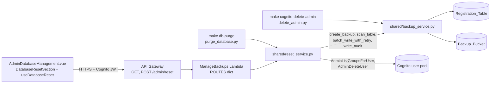
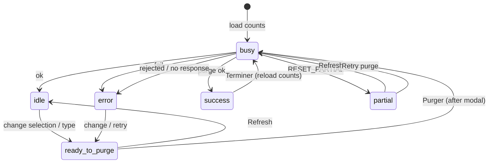

# Design Document: Database Reset (selective purge)

## Overview

The Database_Reset_Section of the admin page "Gestion de la base" lets an Admin purge selected groups of operational data (Purge_Sets) to prepare a new edition. It reuses the implemented and in-production "database-backup-restore" feature for the Pre_Reset_Backup, the admin check, the audit and the page.

Design principles (user constraint, top priority: **simplicity of implementation, no new Lambda**):

| Principle | Consequence |
|---|---|
| No new Lambda | The API stack is at 480 of 500 CloudFormation resources. Two routes are added to the existing `ManageBackupsFunction`. |
| One new shared module | `functions/shared/reset_service.py` holds all reset logic and imports `backup_service` (scan, batch write, backup, audit) instead of duplicating it. |
| One source of truth per layer | Purge_Sets, keys and Dependency_Rules are defined once in `reset_service.py` (backend, CLI) and once in `frontend/src/utils/resetRules.js` (checked by an alignment test). |
| Synchronous | About 1250 items: one HTTP call = one purge, like backup and restore. |
| No new view | `DatabaseResetPlaceholder.vue` is replaced by `DatabaseResetSection.vue` in the existing page. |

### Key decisions

| # | Decision | Choice | Why |
|---|---|---|---|
| 1 | API | ONE resource `/admin/reset`, `GET` (Item_Counts + environment) and `POST` (purge), routed in the `ROUTES` dict of `manage_backups.py` | 8 CloudFormation resources (see below), no Lambda |
| 2 | Selection validation | **Strict**: a selection that is not closed under the Dependency_Rules is rejected with `INVALID_SELECTION` naming the missing sets (the closure is never silently applied) | Requirements 4.7 and 4.8 ask for rejection. The UI always sends the closed selection. The CLI resolves the closure itself before calling the same function |
| 3 | Production backup | Environment read from `os.environ['ENVIRONMENT']` (already in `common_env`), never from the request. In prod a request with `backup_before: false` is rejected with `BACKUP_REQUIRED` (Requirement 8.8); a missing field is treated as `true` | Satisfies 8.8 and 13.3; the UI locks the checkbox so the case only happens on a forged request |
| 4 | Backup category | `safety-pre-reset` added to `backup_service`, no source part, shown in the list with its own badge, restorable (the undo path) | Reuses `create_backup`, restore and list unchanged |
| 5 | Cognito admin exclusion | `AdminListGroupsForUser` per account (fail closed: a check that errors skips the account and reports it) | As requested. About 34 accounts, so about 70 calls, a few seconds |
| 6 | Cognito count in the modal | "up to N accounts" where N = number of `USER#<sub>` PROFILE items; admins are excluded at execution | Computing the exact number needs one Cognito call per account on every page load. The modal states the exclusion (Requirement 6.12 is met in its essence; exact count is a possible later refinement) |
| 7 | Old script `delete_all_data_keep_team_managers.py` | **Deleted and replaced** by `make db-purge`; the Makefile target its docstring mentions (`delete-all-data-keep-managers`) is kept as an alias with preset `SETS` | Simplest way to satisfy 14.13 to 14.16: no second purge implementation to maintain, no wrapper |
| 8 | Section communication | The view holds a template ref on `BackupRestoreSection` (which exposes `selectById` and `reload`) and two busy flags | No store, no event bus |

### What is added where

| Area | Change |
|---|---|
| `functions/shared/backup_service.py` | Category `safety-pre-reset` (constant, naming regex, `make_backup_id`, `parse_backup_id`) |
| `functions/shared/reset_service.py` | **New.** Purge_Sets, Dependency_Rules, counts, validation, purge, Cognito step, result, audit, `handle_counts`, `handle_reset` |
| `functions/admin/manage_backups.py` | 2 entries in `ROUTES` |
| `infrastructure/stacks/api_stack.py` | Resource `/admin/reset` with GET and POST on the existing integration; one IAM statement |
| `scripts/database/purge_database.py` | **New.** CLI over `reset_service` (purge, dry run, backup only) |
| `scripts/database/delete_admin.py` | **New.** Admin_Deletion_Tool |
| `scripts/database/delete_team_manager.py` | Refuses admin accounts |
| `scripts/database/delete_all_data_keep_team_managers.py` | Deleted |
| `infrastructure/Makefile` | `db-purge`, `delete-all-data-keep-managers` (alias), `cognito-delete-admin`; `db-reset` corrected |
| Frontend | `utils/resetRules.js`, `composables/useDatabaseReset.js`, `components/admin/DatabaseResetSection.vue` and `DatabaseResetResultPanel.vue`; edits to `backupNaming.js`, `BackupRestoreSection.vue`, `AdminDatabaseManagement.vue`, i18n; `DatabaseResetPlaceholder.vue` deleted |
| Tests | `tests/integration/test_database_reset.py`, `test_database_reset_scripts.py`, shared helpers, vitest files |

Not added: Lambda, API resource beyond `/admin/reset`, permission matrix entry, `init_config.py` change, migration, bucket, table, async job.

## Architecture



### CloudFormation resource estimate (limit 500, measured 480)

Read from `api_stack.py`: the backups block creates resources with `add_resource` and attaches ONE shared `LambdaIntegration` (`manage_backups_integration`) with `add_method(..., authorizer=self.authorizer, authorization_type=COGNITO)`. `default_cors_preflight_options` adds an `OPTIONS` method to every resource. For each `add_method` with a Lambda proxy integration, CDK adds the `AWS::ApiGateway::Method` plus two `AWS::Lambda::Permission` (deployed stage and test-invoke).

| New resource | Count |
|---|---|
| `AWS::ApiGateway::Resource` (`reset`) | 1 |
| `AWS::ApiGateway::Method` GET, POST | 2 |
| `AWS::Lambda::Permission` (2 per method) | 4 |
| `AWS::ApiGateway::Method` OPTIONS (CORS preflight, MOCK, no permission) | 1 |
| Extra IAM statement on the existing role policy | 0 (statement added to the existing `DefaultPolicy`) |
| Lambda, role, log group, layer, deployment | 0 (the API deployment is one resource whose hash changes) |
| **Total added** | **8** |

**Expected total: 480 + 8 = 488 of 500.** To verify after implementation: `make synth ENV=dev` and recount.

Fallbacks if the limit becomes tight:

| Fallback | Saving | Cost |
|---|---|---|
| Single `POST /admin/reset`; counts requested with `{"dry_run": true}` | 3 (total 485) | The UI loads counts with a POST. Only the `ROUTES` keys, the CDK loop and the composable's load call change |
| Declare GET/POST on the existing `/admin/backups` resource (`reset` kept in the body) | 5 | Semantically odd, last resort |

### IAM

`_create_lambda_function` already grants, for every Lambda: table read/write and, on the user pool, `AdminCreateUser, AdminSetUserPassword, AdminUpdateUserAttributes, AdminAddUserToGroup, AdminGetUser, ListUsers, ListUsersInGroup, ResendConfirmationCode`. Missing: `AdminDeleteUser` and `AdminListGroupsForUser`. They are added with `manage_backups_function.add_to_role_policy(...)` on the user pool ARN, **not** in the shared statement, so only this function can delete users. `add_to_role_policy` appends a statement to the function role's existing `DefaultPolicy` (already present because of the existing grants): no new CloudFormation resource.

```python
manage_backups_function.add_to_role_policy(
    iam.PolicyStatement(
        actions=['cognito-idp:AdminDeleteUser', 'cognito-idp:AdminListGroupsForUser'],
        resources=[self.auth_stack.user_pool.user_pool_arn]))
```

The Cognito username of every account is its `sub` (the pool signs in with email only, `username=False`), so `Username=<sub from the USER#<sub> key>` is valid for both calls.

### Duration (about 1250 items, synchronous, Lambda timeout 120 s)

| Step | Estimate |
|---|---|
| Validation | under 0.1 s |
| Pre_Reset_Backup (scan, S3 put, native `CreateBackup`) | about 2 to 3 s |
| Scan and classification | under 1 s |
| Deletion, worst case about 800 items = 32 `BatchWriteItem` | about 3 s |
| Cognito, 34 accounts, 2 calls each | about 4 to 7 s |
| Audit | under 0.1 s |
| **Total, everything selected** | **about 10 to 15 s** (under the 29 s API Gateway limit) |

Same rule as restore: the Lambda keeps running after an API Gateway 504, and the UI shows the outcome-unknown message.

## Components and Interfaces

### `backup_service.py` changes (category `safety-pre-reset`)

| Item | Change |
|---|---|
| Constants | `CATEGORY_RESET = "safety-pre-reset"`; `CATEGORIES = (manual, safety-pre-restore, safety-pre-reset)` |
| Naming | `safety-pre-reset_{timestamp}.json`, no source part. Native name `{table}-safety-pre-reset_{timestamp}` (unchanged formula) |
| Regex | `_CAT = manual\|safety-pre-restore\|safety-pre-reset` used for the id category AND inside `_STEM` (the source of a `safety-pre-restore` can now be a `safety-pre-reset`: this is the undo path) |
| `make_backup_id` / `parse_backup_id` | A source part is required for `safety-pre-restore` only and forbidden for the two others |
| `create_backup`, `list_backups`, `restore_backup`, `build_envelope` | Unchanged (category comes from the id) |

Restoring a pre-reset backup produces `safety-pre-restore_{ts}_before-restore-of_safety-pre-reset_{ts}.json`. The id stays bounded.

Frontend `backupNaming.js`: `CATEGORY_RESET`, regex alternation, same parse rule, and the badge:

| Category | StatusBadge `status` | Colour | Label (fr) |
|---|---|---|---|
| `manual` | `paid` | blue | Manuelle |
| `safety-pre-restore` | `incomplete` | yellow | Sécurité avant restauration |
| `safety-pre-reset` | `forfait` | red | Sécurité avant purge |

`forfait` (red) is chosen over `complete` (green): it is the only remaining colour clearly distinct from blue and yellow, and a backup taken right before a destructive purge should not look "complete/OK". The label text, not the colour, carries the meaning.

### `reset_service.py` (single source of truth)

```python
import backup_service

CONFIRMATION_PHRASE = "PURGER LA BASE"
ADMINS_GROUP = "admins"

# id -> label and key rules. A rule is (PK pattern, SK pattern); a trailing "*" means prefix, otherwise exact.
PURGE_SETS = {
    "boats":       {"label": "Équipages",         "rules": [("TEAM#*", "BOAT#*")]},
    "payments":    {"label": "Paiements",         "rules": [("TEAM#*", "PAYMENT#*")]},
    "crew":        {"label": "Équipiers",         "rules": [("TEAM#*", "CREW#*")]},
    "managers":    {"label": "Team managers",     "rules": [("USER#*", "PROFILE"), ("USER#*", "CONSENT#*")]},
    "temp_access": {"label": "Accès temporaires", "rules": [("TEMP_ACCESS", "USER#*")]},
    "audit_logs":  {"label": "Journaux d'audit",  "rules": [(pk, "*") for pk in (
        "AUDIT#PERMISSION_BYPASS", "AUDIT#PERMISSION_DENIAL", "AUDIT#PERMISSION_CONFIG",
        "AUDIT#TEMP_ACCESS_GRANT", "AUDIT#TEMP_ACCESS_REVOKE")]},
}
PURGE_ORDER = ("payments", "boats", "crew", "temp_access", "managers", "audit_logs")  # dependents first
DEPENDENCIES = {            # direct and already transitive, so the closure is one union
    "boats": {"payments"},
    "crew": {"boats", "payments"},
    "managers": {"boats", "payments", "crew", "temp_access"},
}
```

Protected_Data (`CONFIG`, `RACE`, `CLUB`, `AUDIT#DATABASE_BACKUP`) is never listed in a rule, so it can never be classified. Items that match no rule (for example other `USER#` or `TEAM#` sort keys) are kept.

| Function | Purpose |
|---|---|
| `classify(pk, sk) -> set_id or None` | First matching set; the rules are disjoint (tested) |
| `resolve_closure(ids) -> set` | `ids` plus `DEPENDENCIES[id]` for each id |
| `compute_item_counts() -> (counts, cognito_accounts_max)` | One `backup_service.scan_table()`, every item classified into at most one set. `cognito_accounts_max` = number of `managers` PROFILE items |
| `validate_request(body) -> (sets, delete_cognito, backup_before)` | Order: phrase, selection, Cognito flag, backup rule (see error table) |
| `execute_reset(body, user) -> result` | Ordered algorithm below. Used by the Lambda **and** the CLI |
| `delete_cognito_accounts(subs) -> dict` | Admin check then `AdminDeleteUser` per account, continue on failure |
| `handle_counts(event, user)`, `handle_reset(event, user)` | Adapters returning `success_response` / `error_response` through `backup_service._run` |

New error classes (subclasses of `backup_service.BackupError`, so `_run` maps them): `InvalidSelection` (400, `INVALID_SELECTION`), `BackupRequired` (400, `BACKUP_REQUIRED`), `PreResetBackupFailed` (500), `ResetPartial` (500, `RESET_PARTIAL`). `InvalidConfirmation` is reused. The Cognito and deletion code reuses `backup_service.batch_write_with_retry` (retry, backoff) and `scan_table`; chunking of 25 is done in `reset_service` so progress can be counted per chunk.

### Routing

```python
ROUTES = {
    # ... five existing /admin/backups routes ...
    ('GET', '/admin/reset'): reset_service.handle_counts,
    ('POST', '/admin/reset'): reset_service.handle_reset,
}
```

### API contract

Both routes: Cognito authorizer plus `@require_admin` (403 for non-admins, nothing done). Responses use the existing envelope.

| Method + path | Request | Success (`data`) |
|---|---|---|
| `GET /admin/reset` | none | `200` `{environment, backup_required, counts: {boats, payments, crew, managers, temp_access, audit_logs}, cognito_accounts_max}` |
| `POST /admin/reset` | `{sets: [ids], delete_cognito: bool, backup_before: bool, confirmation_phrase: "PURGER LA BASE"}` | `200` `PurgeResult` |

`environment` and `backup_required` (`environment == "prod"`) come from the server configuration; the page uses them to lock the backup checkbox.

### Purge algorithm (ordered)

`execute_reset(body, user)`:

| # | Step | On failure | Database modified? |
|---|---|---|---|
| 1 | Admin check (`@require_admin`; CLI is trusted by its AWS profile) | `403 FORBIDDEN` | No |
| 2 | Phrase equals `PURGER LA BASE` exactly (the restore phrase fails this test) | `400 INVALID_CONFIRMATION` | No |
| 3 | Selection: list of known ids, non-empty, closed under `DEPENDENCIES`; `delete_cognito` only with `managers` | `400 INVALID_SELECTION`, `details.missing` or `details.unknown` | No |
| 4 | Backup rule: `ENVIRONMENT == "prod"` and `backup_before is False` | `400 BACKUP_REQUIRED` | No |
| 5 | Pre_Reset_Backup if enabled (or forced in prod): `backup_service.create_backup("safety-pre-reset", user)` | `500 PRE_RESET_BACKUP_FAILED`, `details.failed_artifact` (`json` or `aws_native`), `database_modified: false`. An existing JSON backup is kept | No |
| 6 | Scan once, classify, build `keys_by_set` for the selection. Collect the subs of the `managers` PROFILE items | `500 INTERNAL_ERROR`, `database_modified: false` | No |
| 7 | For each set in `PURGE_ORDER` that is selected: delete its keys in chunks of 25 with `batch_write_with_retry`; add the chunk size to `deleted[set]` after each success | `500 RESET_PARTIAL` (below) | Yes, partially |
| 8 | If `delete_cognito`: `delete_cognito_accounts(subs)`. Runs only after every DynamoDB deletion succeeded. Per account: `AdminListGroupsForUser`; member of `admins`, skip; else `AdminDeleteUser`. `UserNotFoundException` counts as `not_found`; any other error is recorded in `failed` and the loop continues | Reported in the result, never aborts | n/a |
| 9 | `backup_service.write_audit("reset_database", user, details)` after the purge (so the audit survives even when `audit_logs` was purged; `AUDIT#DATABASE_BACKUP` is never classified anyway) | Logged, `audit_written: false` | n/a |
| 10 | Return `PurgeResult` | n/a | n/a |

Failure handling:

- Steps 1 to 6 never modify the table. The backup, if already taken, is reported by id in the error details only when it succeeded.
- Step 7 failure: the exception is caught once, `RESET_PARTIAL` is raised with `details = {stage: <set id being deleted>, deleted: {...counts reached}, pre_reset_backup_id, cognito: "not_attempted"}`, and an audit record with `outcome: "partial"` is written first. The Cognito step is not run, so no account is lost while data remains.
- Retrying the purge after a partial failure is safe: deletes are idempotent. The retry takes a new Pre_Reset_Backup of the partial state; the original one stays in the list.

Audit details (`write_audit` drops `None` values, so absence is explicit):

| Field | Value |
|---|---|
| `outcome` | `success` or `partial` |
| `sets` | selected ids including implied ones |
| `deleted` | `{set_id: count}` |
| `delete_cognito`, `cognito_deleted`, `cognito_failed` | bool, int, int |
| `backup_taken`, `pre_reset_backup_id` | bool, id (omitted when not taken) |
| `environment` | from `ENVIRONMENT` |

### Fallback CLI: `scripts/database/purge_database.py`

| Aspect | Design |
|---|---|
| Imports | `sys.path.insert(0, <repo>/functions/shared)` then `import reset_service`. `backup_service` imports `responses` as a flat module, and `responses` only imports the standard library, so this works without the Lambda layer. `boto3` comes from the infrastructure venv used by `db-migrate` |
| Environment | `configure_environment(env)` sets `ENVIRONMENT`, `TABLE_NAME=impressionnistes-registration-{env}`, `BACKUP_BUCKET=rcpm-impressionnistes-backups-{env}`, `AWS_DEFAULT_REGION=eu-west-3` and `USER_POOL_ID` (CloudFormation output `UserPoolId` of stack `ImpressionnistesAuth-{env}`, same method as `delete_team_manager.py` and `cognito-create-admin`). `AWS_PROFILE` is exported by the Makefile (`rcpm-dev` / `rcpm-prod`) |
| Arguments | `--env`, `--sets a,b` (default `boats`), `--delete-cognito`, `--dry-run`, `--backup-only` |
| Flow | Resolve the closure and print the sets added, print Item_Counts, stop if `--dry-run` (nothing written, no backup, no audit), ask the operator to type `PURGER LA BASE`, call `reset_service.execute_reset(body, cli_user)` with the typed phrase. Validation, prod backup rule, backup, purge, Cognito, partial handling and audit are therefore the same code as the Lambda |
| `--backup-only` | Calls `backup_service.create_backup("safety-pre-reset", cli_user)` and prints the id. Used by `db-reset` |
| User identity | `{"user_id": "cli", "email": "cli:<os user>"}` in the audit |

Makefile (names follow existing targets; recipe lines elided):

| Target | Behaviour |
|---|---|
| `db-purge ENV= SETS=boats DELETE_COGNITO=0 DRY_RUN=0` | In prod and not dry run, asks `Type 'PURGE PROD' to confirm` (same pattern as `DEPLOY PROD`), then runs the script with `$(PYTHON)` |
| `delete-all-data-keep-managers` | Alias: `$(MAKE) db-purge SETS=crew,temp_access,audit_logs` (keeps `managers`, as the old script did; `crew` implies boats and payments) |
| `cognito-delete-admin EMAIL= ENV= WITH_PROFILE=0` | Prod confirmation `DELETE ADMIN PROD`, then `delete_admin.py` |
| `db-reset` | Corrected as below |

`scripts/database/README.md` and the docstring references are updated; the old script is deleted.

### `db-reset` corrections (Requirements 14.17 to 14.20)

Purpose unchanged (delete `TEAM#`/`USER#` items and `CONFIG`, then `reinit_config.py`; `AUDIT#DATABASE_BACKUP` is not touched by its scan filter).

| Change | How |
|---|---|
| Backup first | New first step runs `$(PYTHON) ../scripts/database/purge_database.py --env $(ENV) --backup-only`; the target stops if it fails |
| Typed confirmation | `read -p "Type 'PURGER LA BASE' to confirm"` replaces `RESET` |
| Real race count | The final summary runs `aws dynamodb query ... --select COUNT` on `PK = RACE` and prints it; the hardcoded "42" is removed from the warning and the summary |

### `delete_team_manager.py` (Requirement 14.21)

After the Cognito lookup and before any DynamoDB deletion, call `admin_list_groups_for_user`; if `admins` is in the result, print the refusal and `sys.exit(1)`. Implemented as a small `is_admin(cognito, pool_id, username)` function reused by `delete_admin.py`.

### Admin deletion tool: `scripts/database/delete_admin.py` (Requirement 15)

Ordered checks, each stopping without any modification:

| # | Check or step | Outcome |
|---|---|---|
| 1 | `admin_get_user(Username=EMAIL)` | not found: report, exit |
| 2 | `admin_list_groups_for_user`: `admins` present | else refuse, point to `delete-team-manager` |
| 3 | `list_users_in_group("admins")` (paginated) has more than one member | else refuse: last admin |
| 4 | Print email, groups, environment; operator types the email exactly | mismatch: nothing done, no backup |
| 5 | (Makefile already asked `DELETE ADMIN PROD` in prod) | |
| 6 | `WITH_PROFILE=1` only: `backup_service.create_backup("safety-pre-reset", cli_user)` | failure: abort, nothing modified |
| 7 | `WITH_PROFILE=1` only: query `PK = USER#<sub>`, delete items in chunks of 25 | |
| 8 | `admin_delete_user` | |
| 9 | `backup_service.write_audit("delete_admin", cli_user, {sub, email, environment, profile_deleted, profile_items_deleted, pre_reset_backup_id})` | audit failure: warning printed |
| 10 | Report: account deleted, items deleted, backup id | |

Default (`WITH_PROFILE` unset) deletes only the Cognito account. The page has no equivalent action (Requirement 15.2). Note: the file name starts with `delete_`, so `db-migrate` lists it as a migration like `delete_team_manager.py`; it is not meant to be run that way.

### Frontend

#### Files

| File | Role |
|---|---|
| `utils/resetRules.js` | Pure logic mirrored from the backend: `PURGE_SET_IDS` (UI order), `DEPENDENCIES`, `DEFAULT_SELECTION = ['boats']`, `CONFIRMATION_PHRASE`, `closure(ids)`, `requiredBy(id, selection)` (selected sets that imply `id`), `isPhraseValid(text)` |
| `composables/useDatabaseReset.js` | API calls and the 6-state model (same structure as `useBackupRestore.js`); exports `nextStateFromResetError(err)` |
| `components/admin/DatabaseResetSection.vue` | Banner, Item_Counts and checkboxes, "Tout purger", Cognito option, backup option, phrase `FormGroup`, purge button, `BaseModal` confirmation |
| `components/admin/DatabaseResetResultPanel.vue` | `success`, `error`, `partial` content (like `RestoreResultPanel.vue`) |
| `views/admin/AdminDatabaseManagement.vue` | Hosts both sections, template ref on the backup section, busy flags |
| `components/admin/BackupRestoreSection.vue` | `defineExpose({ selectById, reload: load })`, `externalBusy` prop, emits `busy-change` |
| `components/admin/DatabaseResetPlaceholder.vue` | Deleted |
| `locales/fr.json`, `en.json` | `admin.database.reset.*`, `admin.database.category.safety-pre-reset`, error codes under `admin.database.errors` |

All controls use `BaseButton` (`medium` for panel and modal actions, `small` for row actions), `StatusBadge`, `FormGroup`, `MessageAlert`, `BaseModal`, `DataCard`, and design tokens only. The checkboxes are native inputs in labels (the project has no checkbox component). The section header and the cards keep the bottom-border separator rule.

#### Selection and locking (Requirements 3, 4, 6)

- Each `PURGE_SET_IDS` entry shows: checkbox, label, description, Item_Count.
- `effective = closure(chosen)`. A set in `effective` but not in `chosen` is checked and disabled, with the text "requis par {labels}" from `requiredBy`. Unchecking a chosen set recomputes `effective`, which unlocks the sets no longer implied.
- On load: `chosen = ['boats']`, so "Paiements" is checked and locked with the message about orphaned payments. The phrase is empty, the Cognito option unchecked.
- "Tout purger" sets `chosen` to every id and leaves the Cognito option unchecked.
- The Cognito option is rendered only when `effective` contains `managers`; it is reset to unchecked when `managers` leaves `effective`. It carries the irreversibility, restore and admin-exclusion warnings, and the warning that unchecked accounts can still log in without a profile.
- The backup checkbox is checked by default. When `backup_required` (prod) it is checked and disabled with an explanation; otherwise unchecking it shows "la purge ne pourra pas être annulée".

#### UI state model

| State | Meaning | Banner (fr, summary) |
|---|---|---|
| `idle` | Counts loaded, selection untouched (default) | "Prêt. Sélectionnez les données à purger." |
| `busy` | `loading` counts or `purging` | "{opération} en cours…" |
| `ready_to_purge` | The Admin changed the selection or typed in the phrase field | "Purge de : {labels}. Saisissez la phrase de confirmation." |
| `success` | Purge done | "Purge terminée : {total} éléments supprimés." |
| `error` | Request rejected or failed before deletion, or outcome unknown | Error message and "Rien n'a été modifié dans la base" (outcome-unknown variant when no response) |
| `partial` | `RESET_PARTIAL` | "ÉTAT PARTIEL : la purge n'est pas terminée" |

Enabled actions (`✔` enabled, `—` disabled; the backup section is also disabled while this section is `busy`, and `Purger…` is disabled while the backup section is busy):

| State | Checkboxes and "Tout purger" | Cognito and backup options | Phrase input | Purger… | Refresh counts | Restaurer cette sauvegarde |
|---|---|---|---|---|---|---|
| `idle` | ✔ | ✔ | ✔ | ✔ only if phrase valid | ✔ | hidden |
| `busy` | — | — | — | — | — | — |
| `ready_to_purge` | ✔ | ✔ | ✔ | ✔ only if phrase valid and selection non-empty | ✔ | hidden |
| `success` | hidden | hidden | hidden | hidden | ✔ ("Terminer") | ✔ if a backup was taken |
| `error` | ✔ | ✔ | ✔ | ✔ only if phrase valid | ✔ ("Réessayer") | hidden |
| `partial` | — (selection frozen for the retry) | — | ✔ (empty) | ✔ only if phrase valid (retry) | ✔ | ✔ if a backup was taken |

`ready_to_purge` is entered from `idle` or `error` on the first change. The confirmation modal is a UI detail of `ready_to_purge`: it lists each effective set with count and an "impliqué" mark, the kept sets and Protected_Data ("Configuration", "Courses", "Clubs", "Historique des sauvegardes"), the Cognito option ("jusqu'à N comptes, irréversible, les admins sont exclus") and the backup option.



#### Error classification (`nextStateFromResetError`)

| Error | State |
|---|---|
| `error.code === 'RESET_PARTIAL'` | `partial` |
| Any other envelope code (`INVALID_SELECTION`, `INVALID_CONFIRMATION`, `BACKUP_REQUIRED`, `PRE_RESET_BACKUP_FAILED`, `FORBIDDEN`, `INTERNAL_ERROR`) | `error`, translated message |
| No response, `ECONNABORTED`, HTTP 401 or 504, non-envelope body | `error` with the outcome-unknown message: refresh the backup list, check for a new `safety-pre-reset` backup, verify the database before acting |

#### Result panel and link with the backup section

- `success`: per-set counts, Cognito result (deleted, failed with sub list, admins skipped, not found), boat numbering message when `boats` was purged, the reminder to update registration dates, payment deadline and competition date (no configuration is changed), the Pre_Reset_Backup id with category badge and the button "Restaurer cette sauvegarde", and, when accounts were deleted, "la restauration ne restaure pas les comptes Cognito". Without a backup: "la purge ne peut pas être annulée".
- `partial`: banner, counts reached, set being deleted, backup id and the same restore button, or "aucune sauvegarde de pré-purge: restauration impossible".
- Clicking "Restaurer cette sauvegarde" emits `restore-backup(id)`. The view runs `await backupSection.value.reload()` (the new backup is not in the loaded list) then `backupSection.value.selectById(id)` and scrolls to the backup section. The Admin still types `RESTAURER LA BASE` there.
- On `success` the composable reloads the counts, and the view calls `backupSection.reload()`.

## Data Models

### PurgeResult (`POST /admin/reset`, 200)

```json
{
  "sets": ["boats", "payments", "crew"],
  "deleted": {"payments": 25, "boats": 86, "crew": 372},
  "total_deleted": 483,
  "cognito": {"requested": false, "deleted": 0, "skipped_admins": 0, "not_found": 0, "failed": []},
  "pre_reset_backup": {
    "backup_id": "safety-pre-reset_2026-11-02T09-00-00Z.json",
    "native_backup": {"name": "impressionnistes-registration-prod-safety-pre-reset_2026-11-02T09-00-00Z", "arn": "arn:aws:dynamodb:..."}
  },
  "audit_written": true,
  "duration_ms": 9800
}
```

`pre_reset_backup` is `null` when no backup was taken. `cognito.failed` is a list of `{sub, code}`. With `delete_cognito: false`, `cognito` is `{"requested": false, ...zeros}`.

### `RESET_PARTIAL` error details

`{stage: "crew", deleted: {"payments": 25, "boats": 86, "crew": 120}, pre_reset_backup_id: "safety-pre-reset_...json" | null, cognito: "not_attempted"}`

### Item counts (`GET /admin/reset`)

`{environment: "prod", backup_required: true, counts: {"boats": 86, "payments": 25, "crew": 372, "managers": 100, "temp_access": 2, "audit_logs": 200}, cognito_accounts_max: 34}` (`managers` = 34 profiles + 66 consents).

### Constants kept aligned

| Constant | Backend | Frontend |
|---|---|---|
| Set ids, order, dependencies, phrase | `reset_service.py` | `utils/resetRules.js` |
| Category `safety-pre-reset`, regex alternation | `backup_service.py` | `utils/backupNaming.js` |
| Error codes | Error table | `errors.<CODE>` i18n keys |

An alignment test reads `resetRules.js` the same way `test_frontend_backend_constants_aligned` reads `backupNaming.js`.


## Correctness Properties

*A property is a characteristic or behavior that should hold true across all valid executions of a system-essentially, a formal statement about what the system should do. Properties serve as the bridge between human-readable specifications and machine-verifiable correctness guarantees.*

**Validation approach:** the project forbids Hypothesis. Each property is validated by explicit parametrized pytest cases (backend, moto) or table-driven vitest cases (frontend). The six Purge_Sets give only 64 selections, so the selection properties enumerate all subsets. Reflection: Item_Count (2.3 to 2.5) and result counts (11.2) are merged into Property 3; the audit and partial-failure criteria stay separate because they test different outputs.

### Property 1: Classification is disjoint and never touches protected data

*For any* item key (including keys of every kind in the table: `TEAM#`, `USER#`, `TEMP_ACCESS`, the five `AUDIT#` purge partitions, `AUDIT#DATABASE_BACKUP`, `CONFIG`, `RACE`, `CLUB`, and keys matching no rule), `classify` returns at most one Purge_Set, returns `None` for every Protected_Data key, and returns `crew` for `SK` starting with `CREW#` but not for `CREW_MEMBER#`.

**Validates: Requirements 2.4, 2.5, 5.3, 7.1**

### Property 2: Dependency closure

*For any* subset of the six set ids, `resolve_closure` contains the subset, is idempotent, and contains exactly the sets required by the Dependency_Rules (`boats` implies `payments`; `crew` implies `boats`, `payments`; `managers` implies `boats`, `payments`, `crew`, `temp_access`). The frontend `closure` and the backend `resolve_closure` return the same result for all 64 subsets. In the UI, *for any* sequence of check and uncheck actions, the locked sets are exactly `closure(chosen) \ chosen`, each shows the sets that require it, and unchecking unlocks the sets no longer implied.

**Validates: Requirements 3.2, 4.1, 4.2, 4.3, 4.4, 4.5, 4.6**

### Property 3: Purge deletes exactly the selected sets and reports exact counts

*For any* table content and any valid selection, after the purge the remaining items equal the items before minus the items classified in the selected sets; every Protected_Data item and every item of an unselected set is unchanged; `deleted[set]` equals the Item_Count of that set computed before the purge; and `GET` counts equal the independently tallied counts of the seeded table.

**Validates: Requirements 2.3, 2.4, 2.5, 5.1, 5.2, 5.3, 5.4, 5.5, 11.2**

### Property 4: Invalid selections are rejected without effect

*For any* request whose selection is empty, contains an unknown id, is not closed under the Dependency_Rules, is not a list, or has `delete_cognito` true without `managers`, the response is `INVALID_SELECTION` (naming the missing or unknown ids when applicable), no Pre_Reset_Backup is taken, and the table is unchanged. *For any* of the 64 subsets, the request is accepted if and only if the subset is non-empty and closed.

**Validates: Requirements 4.7, 4.8, 4.9, 6.13**

### Property 5: Only the exact confirmation phrase authorizes a purge

*For any* phrase that is not exactly `PURGER LA BASE` (different case, extra whitespace, empty, missing, the restore phrase `RESTAURER LA BASE`), the response is `INVALID_CONFIRMATION`, no backup is taken and the table is unchanged. The same holds for the CLI when the typed text differs.

**Validates: Requirements 9.1, 9.2, 9.8, 9.9, 9.10, 14.9, 14.10**

### Property 6: The Pre_Reset_Backup precedes deletion and its failure aborts the purge

*For any* valid selection with the backup enabled, a complete `safety-pre-reset` backup (JSON object and native backup) whose item set equals the pre-purge table exists before the first delete is issued; *for any* failure of the JSON or native backup, the response is `PRE_RESET_BACKUP_FAILED` naming the failed artifact and the table is unchanged.

**Validates: Requirements 8.1, 8.2, 8.3, 8.9, 14.5, 14.7**

### Property 7: Production requires the backup, decided server-side

*For any* combination of `ENVIRONMENT` in {`prod`, `dev`} and `backup_before` in {`true`, `false`, missing}, plus any extra `environment` field in the request body: `prod` with `false` returns `BACKUP_REQUIRED` and changes nothing; `prod` with `true` or missing takes the backup; `dev` with `false` purges without a backup and returns `pre_reset_backup: null`. The request body never changes the outcome of the environment check.

**Validates: Requirements 8.6, 8.7, 8.8, 8.12, 13.3, 14.6**

### Property 8: Backup identifier and category

*For any* UTC time, `make_backup_id("safety-pre-reset", t)` matches `^safety-pre-reset_{timestamp}\.json$`, parses back to the same category and timestamp, has no source part, and is rejected when a source is given; the native name `{table}-safety-pre-reset_{timestamp}` matches `^[a-zA-Z0-9_.-]{3,255}$`. Restoring a `safety-pre-reset` backup yields a `safety-pre-restore` id whose `source_ref` is `safety-pre-reset_{timestamp}`. The Python and JavaScript regexes accept the same shared sample ids and reject the same invalid ones, and `list_backups` returns the category `safety-pre-reset`.

**Validates: Requirements 8.3, 8.4, 8.5**

### Property 9: Cognito deletion rules

*For any* set of team managers and admins in the pool (including a profile whose Cognito account is missing), with the option checked: every account outside the `admins` group is deleted after all DynamoDB deletions have succeeded; no member of `admins` is ever deleted; an account whose deletion (or group check) fails is reported in `failed` and the remaining accounts are still processed; with the option unchecked no account is deleted.

**Validates: Requirements 6.6, 6.7, 6.9, 6.10, 6.11**

### Property 10: Partial failure reports what was done and stops before Cognito

*For any* purge selection and any failure injected while deleting a given set, the response is `RESET_PARTIAL` with the stage (that set), the deleted counts reached, and the Pre_Reset_Backup id (or null); an audit record with outcome `partial` and those counts is written; no Cognito account is deleted; and restoring the Pre_Reset_Backup returns the table to its pre-purge item set.

**Validates: Requirements 7.8, 12.1, 12.2**

### Property 11: Every purge is audited and the backup history is preserved

*For any* successful purge, exactly one `reset_database` record exists under `AUDIT#DATABASE_BACKUP` with the effective sets (implied included), per-set deleted counts, the Cognito flag and counts, the backup id or `backup_taken: false`, the Admin identity and the UTC timestamp, written after the purge; *for any* selection, every `AUDIT#DATABASE_BACKUP` record present before the purge is present after it, including when `audit_logs` is selected.

**Validates: Requirements 7.1, 7.2, 7.3, 7.4, 7.5, 7.6, 7.7, 7.9**

### Property 12: Non-admin requests are rejected without effect

*For any* of the two reset routes and any non-admin caller, the response is 403 and no S3 object, native backup, table item or Cognito account is created, changed or deleted.

**Validates: Requirements 1.1, 1.2**

### Property 13: UI action availability and error classification

*For any* of the six UI states, the enabled actions equal the documented table; the purge action is disabled unless the typed text equals the Confirmation_Phrase and the effective selection is non-empty and the backup section is not busy; in `busy` every action is disabled. *For any* purge error, the state is `partial` for `RESET_PARTIAL`, and `error` for every other code and for no response, with the outcome-unknown message in the no-response case; the Cognito option is shown only when `managers` is in the effective selection and is unchecked whenever it becomes hidden or "Tout purger" is used.

**Validates: Requirements 2.7, 2.8, 6.1, 6.2, 6.3, 9.2, 9.3, 10.3, 10.4, 10.5, 10.6, 10.7, 12.3, 12.6**

### Property 14: The CLI applies the same rules and a dry run changes nothing

*For any* `SETS` value, the CLI resolves the same closure as `resolve_closure` and calls `execute_reset` (so Properties 3 to 11 apply to it); with `--dry-run` the table, the backup bucket, native backups, Cognito and the audit records are unchanged. `delete_team_manager.py` refuses *any* account that belongs to `admins` without deleting anything.

**Validates: Requirements 14.2, 14.3, 14.4, 14.11, 14.12, 14.21**

### Property 15: Admin deletion guards leave everything untouched

*For any* of: unknown email, account not in `admins`, last remaining admin, typed email different from the account email, Pre_Reset_Backup failure with `WITH_PROFILE=1`: the tool deletes no Cognito account, no table item and writes no `delete_admin` audit record; no backup is taken when the typed email differs.

**Validates: Requirements 15.3, 15.4, 15.5, 15.8, 15.12**

## Error Handling

All errors use `error_response(status, code, message, details)`; the UI translates by `code`; no stack trace is returned.

| Code | HTTP | When | Database modified? | UI state |
|---|---|---|---|---|
| `UNAUTHORIZED` / `FORBIDDEN` | 401 / 403 | No token / not in `admins` | No | login redirect / unreachable |
| `NOT_FOUND` | 404 | Unknown route | No | `error` |
| `INVALID_CONFIRMATION` | 400 | Phrase differs, missing, or body not JSON | No | `error` |
| `INVALID_SELECTION` | 400 | Empty, unknown id, not closed (`details.missing`, `details.unknown`), not a list, Cognito without `managers` | No | `error` |
| `BACKUP_REQUIRED` | 400 | `ENVIRONMENT == prod` and `backup_before` is false | No | `error` |
| `PRE_RESET_BACKUP_FAILED` | 500 | JSON or native backup failed (`details.failed_artifact`) | No | `error` |
| `RESET_PARTIAL` | 500 | Deletion failed after it started | **Yes (partial)** | `partial` |
| `INTERNAL_ERROR` | 500 | Unexpected error before deletion (`database_modified: false`) | No | `error` |
| (no response, 504) | n/a | Network error or API Gateway timeout | Unknown | `error` (outcome unknown) |

- Cognito failures never produce an error: they are reported in `PurgeResult.cognito.failed`.
- Validation order is fixed: phrase, selection, Cognito flag, backup rule, so the response code is deterministic and no backup is ever taken for an invalid request.
- Exceptions are logged with `logger.error(..., exc_info=True)` only.

## Testing Strategy

**Property-based testing is applicable** to the pure logic (classification, closure, selection validation, naming, state table), but the project forbids Hypothesis: every property is validated by explicit parametrized pytest cases or table-driven vitest cases, so no property-testing library, iteration count or tag format applies. Infrastructure (CDK, Makefile) has no automated test in this project; it is checked by review of `make synth ENV=dev` and by the dev run.

### Backend (pytest + moto 4.2.9, `make test-backend`, single file `make test-backend-one TEST=tests/integration/test_database_reset.py`)

Cognito: `mock_cognitoidp` in moto 4.2.9 implements `AdminDeleteUser`, `AdminListGroupsForUser`, `ListUsersInGroup`, `AdminGetUser`, `CreateGroup`, `AdminAddUserToGroup` (read in `moto/cognitoidp/responses.py` of `tests/venv`). Test users are created with `Username=<sub>` so the key sub equals the Cognito username, as in production.

| Item | Decision |
|---|---|
| Shared test code | Create `tests/integration/conftest.py` holding the fixtures `reset_backup_clients` (autouse) and `backup_bucket` moved from `test_database_backup_restore.py`, plus the new fixture `cognito_pool` (moto pool, `admins` group, helper to add users and put `USER_POOL_ID`). Create `tests/integration/backup_helpers.py` with the plain helpers `clear_table`, `put_typed_items`, `items_by_key`, `table_state`, `utc`, `ADMIN_USER`. `test_database_backup_restore.py` imports them instead of defining them (behaviour unchanged). Both new test files use them. The import style follows the other integration tests (verify at implementation) |
| New files | `tests/integration/test_database_reset.py` (service and handler), `tests/integration/test_database_reset_scripts.py` (`purge_database`, `delete_admin`, `delete_team_manager` loaded with `importlib` from `scripts/database`) |
| Existing tests updated | `test_database_backup_restore.py`: parametrized naming cases (add `safety-pre-reset` valid, with source invalid), `test_backup_id_rejects_invalid`, the assertion `alternation == 'manual\|safety-pre-restore'` and the JS regex structure test (now three categories), shared sample ids, one restore-of-a-reset-backup case |
| Seed | A `reset_table` helper seeds one item of every key kind (plus several `TEAM#` owners, `CREW_MEMBER#` decoy, backup audit records, items matching no rule) after `clear_table` |
| Failure injection | Same fault-injection wrappers as the backup tests: failing S3 `put_object`, failing `create_backup`, failing `batch_write_item` on the Nth call, failing `admin_delete_user` for chosen subs |
| Environment | `monkeypatch.setenv('ENVIRONMENT', 'prod' or 'dev')`; the request body may carry a misleading `environment` field |

| Test (parametrized where noted) | Properties |
|---|---|
| `test_classify_keys` (every key kind, decoys) and `test_rules_are_disjoint` | 1 |
| `test_closure_all_subsets` (64) and `test_frontend_backend_reset_rules_aligned` (ids, order, dependencies, phrase read from `resetRules.js`) | 2 |
| `test_counts_match_seed`, `test_purge_scope_and_counts` (selections: default, all, each set alone with closure, no `audit_logs`) | 3 |
| `test_invalid_selection_rejected` (empty, unknown, each non-closed subset, non-list, Cognito without managers) and `test_selection_accepted_iff_closed` (64) | 4 |
| `test_wrong_phrase_rejected` (empty, case, whitespace, restore phrase, missing, non-JSON body) | 5 |
| `test_backup_taken_before_first_delete`, `test_backup_failure_aborts` (json, aws_native) | 6 |
| `test_prod_backup_rule` (environment x flag x misleading body field) | 7 |
| `test_reset_backup_id_naming`, `test_list_shows_reset_category`, `test_restore_of_reset_backup_returns_pre_purge_state` | 8 |
| `test_cognito_deletion` (managers, admins, ghost profile, injected failures, unchecked), `test_cognito_runs_after_dynamodb` | 9 |
| `test_partial_failure_at_each_set`, then restore of the pre-reset backup | 10 |
| `test_audit_record_fields`, `test_backup_audit_history_preserved` | 11 |
| `test_non_admin_rejected` (both routes) | 12 |
| `test_cli_dry_run_changes_nothing`, `test_cli_resolves_closure`, `test_delete_team_manager_refuses_admin` | 14 |
| `test_delete_admin_guards` (unknown, non-admin, last admin, mismatch, backup failure), `test_delete_admin_default_keeps_profile`, `test_delete_admin_with_profile` (backup id and audit fields) | 15 |
| `test_handler_routes_reset` (GET and POST through `lambda_handler` with `resource='/admin/reset'`) | 12 and wiring |

### Frontend (vitest, `make test-frontend`; lint with `make lint-frontend`)

- `utils/resetRules.test.js`: `closure` for all 64 subsets, `requiredBy`, `isPhraseValid`, default selection (Property 2).
- `composables/useDatabaseReset.test.js` (mock `apiClient`): locking and unlocking, "Tout purger", Cognito visibility and reset, backup lock in prod, state transitions, enabled-action table per state, `nextStateFromResetError` table (`RESET_PARTIAL`, other codes, `ECONNABORTED`, 401, 504, no response, non-envelope body) (Properties 2 and 13).
- `utils/backupNaming.test.js`: the new category, regex, badge `forfait`, shared sample ids.
- Component rendering follows the manual checklist.

### Manual verification (dev, then prod; Makefile targets only)

1. `make test-backend`, `make test-frontend`, `make lint-frontend` pass.
2. `make synth ENV=dev`: recount CloudFormation resources (expect 488) and confirm the one added IAM statement and the two methods on `/admin/reset`.
3. `make deploy-dev`, `make deploy-frontend-dev`.
4. Page: counts displayed, default selection (boats checked, payments checked and locked), phrase gate, modal content, `db-view` before and after.
5. Purge boats with a pre-reset backup, then "Restaurer cette sauvegarde" and restore: data returns; the backup list shows the red category badge.
6. Purge with managers and Cognito on a test account set; verify the admin account survives.
7. `make db-purge ENV=dev DRY_RUN=1`, then a real run; `make db-reset ENV=dev` (backup, phrase, race count); `make cognito-delete-admin` on a throwaway admin.
8. Prod: `make deploy-prod`, `make deploy-frontend-prod`; use the page only after a fresh manual backup and outside registration hours.

## Documentation and Requirements Sync (for later)

Per the `documentation-updates` and `requirements-sync` rules these need user confirmation before editing:

| File | Update |
|---|---|
| `docs/reference/api-endpoints.md` | `GET` and `POST /admin/reset`, request, response, error codes |
| `docs/reference/commands.md` | `db-purge`, `delete-all-data-keep-managers` (alias), `cognito-delete-admin`, corrected `db-reset` |
| `scripts/database/README.md` | `purge_database.py`, `delete_admin.py`, removal of `delete_all_data_keep_team_managers.py` |
| `docs/reference/project-structure.md` | `reset_service.py`, `purge_database.py`, `delete_admin.py`, new components |
| `docs/guides/operations/` | Runbook: end-of-edition purge, undo with the pre-reset backup, partial-failure recovery, admin deletion |
| `docs/reference/terminology.md` | Purge sets and the `safety-pre-reset` category |
| `.kiro/specs/database-backup-restore/requirements.md` | Note the third Backup_Category (user confirmation required) |

Alignment statement for implementation: set ids, dependencies and phrase exist on both sides and are checked by `test_frontend_backend_reset_rules_aligned`; the category and regex are checked by the updated backup alignment tests.

Reminder (test rule): after backend changes run `cd infrastructure && make test`.
